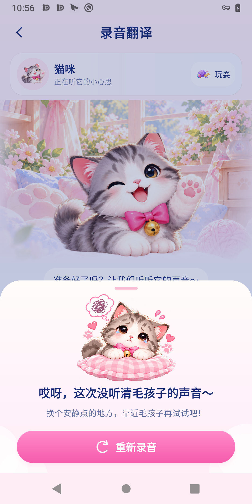
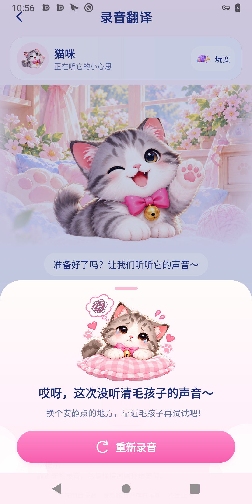
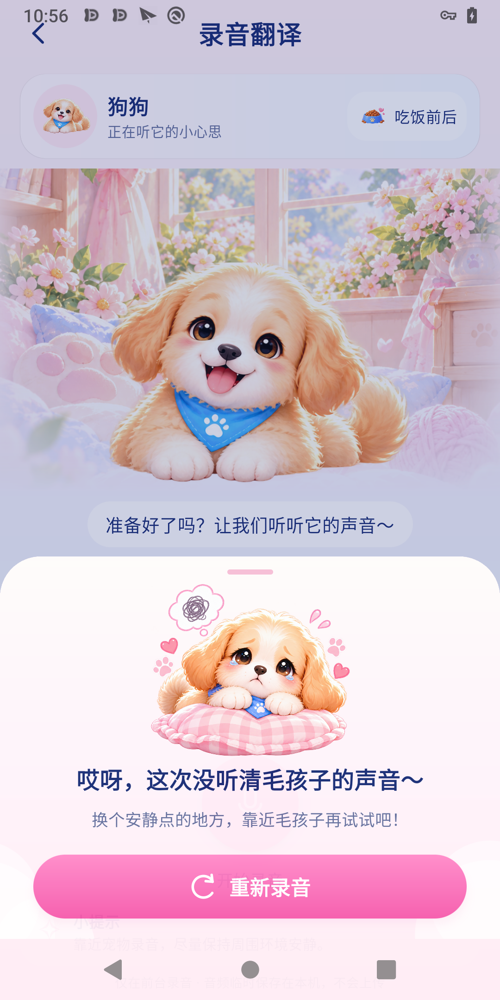

# A1.4.4 声音未识别 BottomSheet 高保真 UI

日期：2026-10-29。验收机：Pixel 3，1080×2160，density 440。

## 修改文件

- `app/src/main/java/com/example/pettranslator/ui/recording/UncertainRecordingSheet.kt`：渐变面板、32dp 大圆角、粉色拖动条、完整委屈萌宠插画、轻柔云朵边角、18sp 标题、13sp 副标题、50dp 渐变胶囊按钮、重录图标和粉色阴影。仅弹窗自身窗口的导航栏底色同步为浅粉，关闭时恢复，不改变录音 Activity 样式。
- `app/src/main/java/com/example/pettranslator/ui/recording/RecordingScreen.kt`：本任务仅在既有调用处传入 `pet = model.pet`，取本次录音会话宠物，不读取首页全局偏好。
- `app/src/main/res/drawable-nodpi/record_uncertain_cat.png`、`record_uncertain_dog.png`：将开发者原有 `.png.png` 文件修正为有效资源名，PNG 内容不改变。
- `app/src/androidTest/java/com/example/pettranslator/UncertainSheetFlowTest.kt`：适配新增 pet 参数，验证猫狗资源及重组、补充横屏短窗口验证。
- `docs/a1.4.4`：参考图、猫狗真机截图、尺寸、资源哈希及验证记录。

其他工作区已有改动来自此前任务。本任务未修改录音状态机、YAMNet、判定阈值、分析时间轴及 UI、录音波形、首页/逗宠、96 条文案、正常结果页、保存分享或权益实现。

## 插画资源检查

| 资源 | 原始尺寸 | Alpha=0 / 1～254 / 255 像素数 | Alpha≥32 的可见边界 |
| --- | --- | --- | --- |
| 猫咪 | 1254×1254，1:1 | 582887 / 989074 / 555 | x=29～1232，y=109～1166 |
| 狗狗 | 1122×1402，约 0.8003:1 | 783355 / 789330 / 359 | x=24～1115，y=218～1161 |

透明通道有效，黑底预览区域是透明区域，未发现棋盘格烘焙背景。资源有明显的多余透明边距，狗狗上下边距尤其大。边缘有少量原素材的淡粉、浅色毛边及低透明度光晕；在奶油粉背景下自然融合，没有重新生成替代图或破坏原图。哈希见 resource-hashes.json。

用 BitmapPainter 的源矩形在显示时去掉透明外围：猫咪 (21,101,1220,1074)，狗狗 (16,210,1106,960)，比测得可见区域额外保留边距。耳朵、眼睛、爪子、完整垫子及原有气泡/爱心/爪印均保留。ContentScale.Fit 保持各自源区域原始比例，不拉伸或压扁。

## 实际布局和高度

- 继续使用原 Material 3 ModalBottomSheet，仍为原会话状态驱动；没有新增导航目的地。
- 顶部圆角 32dp，拖动条 36×4dp；奶油白 → 淡粉渐变、轻柔遮罩。
- 插画布局区域最大宽度 250dp，高度按实际窗口高度 17.5% 计算，限制 118～140dp。当前窗口计算约 137.5dp 高；Fit 后猫咪实际源图显示区域约 156×137.5dp，狗狗约 158×137.5dp；按 Alpha≥32 的可见像素估算，主体与原有装饰约为猫 154×135dp、狗 156×135dp。不是扩大透明区域假装放大主体。
- 插画后 4dp 接主标题；主副标题相距 8dp；副标题与按钮相距 18dp。标题和副标题保留原正式文案，可自然换行，无省略号。
- 按钮高度至少 50dp，左右 26dp，白色重录图标、白字、浅粉到亮粉渐变和轻阴影。点击仍直接调用原有 onAgain 回调。
- 当前截图测得面板顶部约 y=1202px；扣除导航区域后面板高约 826px，可用高度约 1962px，占 **42.1%**。包含系统导航区域的视觉高度为 958px。取样见 measurements.json，系统栏高度及圆角会带来约 1px 误差。
- 弹窗内容上限为窗口高度 86%，较短窗口及大字体允许增高并滚动，避免全屏及截断。系统底部使用安全区内边距，导航区域底色为 #FFEDF5，没有全宽白色断层。

## 猫狗真机截图

真实麦克风录音经现有本地识别返回 UNCERTAIN 的猫咪截图：

受控 UNCERTAIN 会话，用正式 RecordingRoute 渲染的猫咪、狗狗截图：

受控会话用于稳定验证两种宠物资源，不将其描述为真实宠物声音成功识别。

## 与参考效果图对比

| 项目 | 结果和差异 |
| --- | --- |
| 面板 | 保留奶油粉、顶部大圆角、粉色拖动条、半透明遮罩；底部系统安全区域也接上浅粉底色。 |
| 插画 | 使用指定的委屈含泪猫狗及粉色格纹垫子；素材本身比参考图中的猫咪更偏竖向，完整保留比例后视觉更紧凑，未通过横向拉伸追求一致。 |
| 装饰 | 沿用素材中的爱心、爪印、气泡，补少量静态白云边角；没有照搬参考图每一个散落装饰的位置，也没有重复堆叠。 |
| 文案 | 深蓝粗体 18sp、灰蓝 13sp，正式文案不变。使用系统 SansSerif，没有新增字体资源，因此与参考图圆润字形略有区别。 |
| 按钮 | 粉色渐变、白色重录图标、胶囊轮廓及轻阴影；效果比参考图的强高光更克制，没有额外复杂动效。 |
| 高度 | 当前约 42%，完整展示猫狗、垫子、文案和按钮；与参考图不同设备比例下的高度不会完全一致。 |

## 交互及功能保护验证

最终 UncertainSheetFlowTest + RecordingFlowTest 共 **7 项真机测试通过**，见 device-tests.txt：

1. DOG 会话只显示狗狗插画，重建该组合后仍显示狗狗；不会重复运行推理。CAT 会话只显示猫咪插画。
2. 重录按钮回到待录音页，不自动开启麦克风。
3. 点击遮罩、下滑、系统返回关闭均正常；关闭后没有重复弹出、重复采集或重复推理，返回录音页后仍能返回首页。
4. 两倍字体下，标题、副标题、按钮可通过滚动完整显示。
5. 真机横屏短窗口下，狗狗插画和按钮可显示、可滚动；测试后恢复竖屏。
6. PET_MISMATCH 仍沿用独立物种不匹配流程，并可用缓存识别输出切换到成功结果；ANALYSIS_ERROR 仍为独立异常处理及重试，没有混入未识别弹窗。
7. 真实 AudioRecord 手动停止、取消、最长录音自动结束、前后台和 Activity 重建中断流程均通过；UNCERTAIN 重建后仍可关闭。

本任务没有修改免费机会相关逻辑。当前项目依然只有默认放行的 FeatureAccessManager，尚未实现免费次数扣减或持久化；不会因为视觉改造扣除或重新发放机会。

## 工程结果

- assembleDebug：通过。
- lintDebug：通过，0 error，5 条既有依赖更新/结果图导出 KTX 建议，无本次新增 warning。
- testDebugUnitTest：27 项通过，0 failure/error。
- assembleDebugAndroidTest：通过。
- 真机测试：7 项通过。
- git diff --check：通过。

最终构建记录 build.txt；真机记录 device-tests.txt。未引入 Lottie、第三方动效依赖或新业务状态。

## 剩余差异及范围

无已知阻塞。原素材偏竖向、带少量边缘光晕，以及系统字体与参考图的区别保留，未生成替代素材。没有逐一实测多台不同物理设备；已验证同机竖屏、横屏短窗口和两倍字体。弹窗恢复使用原有会话状态和生命周期行为，触发时机及 3～5 秒随机流程没有变动。

A1.4.4 完成后停止，不进入其他模块。
