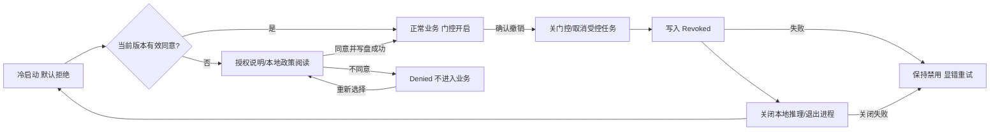

# B2.3 首次隐私授权与真实撤销

已完成最小统一机制；一次构建成功、13项针对性 JVM 测试通过、一轮真机核心流程通过。原先没有首次隐私同意流程，本轮依据用户后续明确授权补齐。没有创建/切换分支、提交或推送；B2.2未提交成果保留。

## 授权与撤销

- 首次无记录默认拒绝；首次弹窗可阅读 B2.2 本地隐私政策、同意、不同意或退出。不同意不构建正常业务页面。
- 只有当前政策版本、Accepted、有效授权时间同时满足才恢复授权；当前版本为 `2026-11-16-draft-1`。
- 独立 DataStore 文件 `files/datastore/privacy_consent.preferences_pb` 保存 `decision`、`policy_version`、`accepted_at_ms`、`revoked_at_ms`。同意/拒绝/撤销使用同一 store/controller，gate 是该机制的进程内执行门控，不是第二份持久化授权。
- 同意：原子 edit 持久化成功后才开启门控。拒绝：门控关闭并保存 Denied。
- 撤销：二次确认后同步关闭门控、取消登记受控 Job；原子 edit 保存 Revoked、移除 accepted_at_ms；等待 YAMNet 关闭后调用 finishAndRemoveTask，继而 killProcess。
- 写入或关闭失败：保持门控关闭，显示错误与重试，不跳回业务、不显示成功、不执行成功退出。重复操作由原子操作锁防重。
- 撤销成功后冷启动读到 Revoked，重新展示同一首次弹窗；重新同意且写入成功后才恢复功能。

## 实际受控组件与边界

- 录音 AndroidPcmRecorder：record入口、AudioRecord创建/启动/读取、文件写入和帧回调检查同一门控；登记受控Job便于撤销取消。
- LiteRT/YAMNet：实例构造/get、推理排队与真正执行、模型加载后的接续、窗口取消检查与结果回调均校验门控；关闭时禁止新任务，取消已有Job/Future，串行关闭引擎并等待executor终止。关闭失败保留实例与禁用状态，不能通过重试丢失失败引用后假称成功。
- 本地推理不等于数据上传。当前没有广告、统计、推送或支付SDK；本轮未添加任何依赖或上报通道。
- AndroidX EmojiCompat/ProcessLifecycle/ProfileInstaller保留：目前是框架字体、生命周期和性能基础设施，未发现它们承载本项目录音、推理或业务上报路径；没有无依据全部禁用自动初始化，也未修改Manifest。
- 已进入的 native load/run 无法承诺瞬时中断：撤销先禁止新操作和回调，等待已开始的调用退回后关闭。若关闭失败，保持禁用并显示错误；真实 native 在途撤销本轮未实测。
- 没有主动撤销Android麦克风等系统权限。正常PCM取消、退出和Application启动清理规则保留，不额外删除持久化业务文件。

## 本轮文件清单

新增：

- [PrivacyConsentController.kt](D:/pettranslator/app/src/main/java/com/example/pettranslator/privacy/PrivacyConsentController.kt)：统一状态机、版本、默认拒绝门控、受控Job登记。
- [AndroidPrivacyConsent.kt](D:/pettranslator/app/src/main/java/com/example/pettranslator/privacy/AndroidPrivacyConsent.kt)：独立DataStore与进程生命周期、退出接线。
- [PrivacyConsentUi.kt](D:/pettranslator/app/src/main/java/com/example/pettranslator/privacy/PrivacyConsentUi.kt)：首次弹窗、政策阅读、拒绝和撤销失败界面。
- [PrivacyConsentControllerTest.kt](D:/pettranslator/app/src/test/java/com/example/pettranslator/PrivacyConsentControllerTest.kt)：13项针对性JVM测试。
- [b23_privacy_acceptance.py](D:/pettranslator/tools/b23_privacy_acceptance.py)：一轮主机驱动真机验收，真实验证进程结束后重启。

增量修改：

- [MainActivity.kt](D:/pettranslator/app/src/main/java/com/example/pettranslator/MainActivity.kt)：业务界面仅在统一授权通过后构建。
- [ProfileScreen.kt](D:/pettranslator/app/src/main/java/com/example/pettranslator/ui/profile/ProfileScreen.kt)：撤销二次确认和回调，其余主UI保留。
- [PetTranslatorApp.kt](D:/pettranslator/app/src/main/java/com/example/pettranslator/ui/navigation/PetTranslatorApp.kt)：功能入口门控和撤销回调，保留B2.2路由。
- [AndroidPcmRecorder.kt](D:/pettranslator/app/src/main/java/com/example/pettranslator/data/recording/AndroidPcmRecorder.kt)：采集执行边界门控和任务登记；录音算法、权限时机、PCM生命周期规则不改。
- [YamnetRecognitionRepository.kt](D:/pettranslator/app/src/main/java/com/example/pettranslator/data/recognition/YamnetRecognitionRepository.kt)：本地推理门控、取消及可靠关闭。
- [ProfileUiEvidenceTest.kt](D:/pettranslator/app/src/androidTest/java/com/example/pettranslator/ProfileUiEvidenceTest.kt)、[ProfilePrivacyFlowTest.kt](D:/pettranslator/app/src/androidTest/java/com/example/pettranslator/ProfilePrivacyFlowTest.kt)：将撤销占位断言替换成真实确认取消断言。

125个保护文件哈希未变：B2.2七TXT、阅读页/权限详情、首页/逗宠/结果UI、推理引擎算法、ViewModel、宠物偏好存储、Application正常PCM清理、Manifest、Gradle、主题和资源均未修改。

## 构建与验收

- 一次 Gradle 调用：assembleDebug + 仅PrivacyConsentControllerTest的testDebugUnitTest + assembleDebugAndroidTest；BUILD SUCCESSFUL in 1m29s，无修复重建。
- 13项JVM测试：0失败；覆盖默认拒绝、fake SDK初始化/处理阻断、同意恢复、拒绝、旧版本/无效时间、读写失败、撤销顺序、任务取消、停止失败、并发去重、业务哨兵。
- 真机：Samsung SM-G973U / Android API31 / 字体1.1；一次覆盖安装、一轮主机驱动验收。未卸载、清数据、修改系统授权或重复验收。

| 用例 | 结果及证据 |
| --- | --- |
| 无授权记录首次启动 | 通过；覆盖安装后首次隐私记录不存在，显示弹窗；不是卸载重装的全新安装 |
| P01 撤销入口 | 真机显示精确文案与确认/取消 |
| P02 取消 | 真机授权文件字节完全不变 |
| P03/P04 确认/写盘/退出 | 真机读出Revoked且Accepted已移除，原PID结束；日志顺序gate_closed→revoked_persisted→controlled_work_stopped→exit |
| P05 冷启动 | 真机重新显示同一授权弹窗，业务界面未出现 |
| P06 未同意阻断 | 真机拒绝状态已持久化，无业务入口、对应PID无YAMNet初始化日志；JVM fake SDK检查阻断，生产入口/执行/回调均有门控 |
| P07 重新同意 | 真机重新写Accepted并进入首页；此前Accepted冷启动不重复弹窗 |
| P08 数据保留 | 真机持久化哨兵与系统权限不变；原设备没有已保存宠物偏好记录，默认状态未额外写入选择；已存非默认宠物样本未实机覆盖，独立存储/源文件哈希及JVM业务哨兵提供补充证据 |
| P09 写入失败 | JVM注入IOException：保持禁用、错误非空、不退出、不显示成功；未制造真机闪存故障 |
| P10 重复确认 | JVM并发两次确认：仅一次写入/停止/退出 |

未覆盖：真实 native 推理/加载在途撤销、真机已有非默认宠物选择样本、实际闪存写入故障。没有把这些边界填写为完整真机通过；本轮不再追加测试或调整。

## 证据与交付

- [首次授权截图](D:/pettranslator/docs/b2.3-privacy-consent/device/first-consent.png)
- [未同意时阅读隐私政策](D:/pettranslator/docs/b2.3-privacy-consent/device/policy-before-consent.png)
- [撤销确认截图](D:/pettranslator/docs/b2.3-privacy-consent/device/revoke-confirmation.png)
- [撤销后冷启动截图](D:/pettranslator/docs/b2.3-privacy-consent/device/revoked-cold-start.png)
- [逐项真机结果](D:/pettranslator/docs/b2.3-privacy-consent/device/acceptance.json)、[实际进程授权日志](D:/pettranslator/docs/b2.3-privacy-consent/device/privacy-logcat.txt)
- [JVM原始结果](D:/pettranslator/docs/b2.3-privacy-consent/unit-tests.xml)、[构建日志](D:/pettranslator/docs/b2.3-privacy-consent/build.txt)
- [修改范围核验](D:/pettranslator/docs/b2.3-privacy-consent/scope-check.json)、[最终验证记录](D:/pettranslator/docs/b2.3-privacy-consent/validation.json)
- [本轮Debug APK](D:/pettranslator/artifacts/pettranslator-b2.3-privacy-consent-debug.apk)

对当前已识别的受控录音和LiteRT/YAMNet路径：撤销成功后，至下一次重新同意并持久化之前，门控默认关闭，不会启动新的录音采集或推理初始化。这个结论不表示AndroidX基础组件全部停止，也不表示撤回或删除历史数据。若未来接入新的采集/上报SDK，必须接入同一门控后重新核验。

当前设备最终处于重新同意后的首页。没有自动commit/push，HEAD/main引用未变；本轮停止等待验收。
